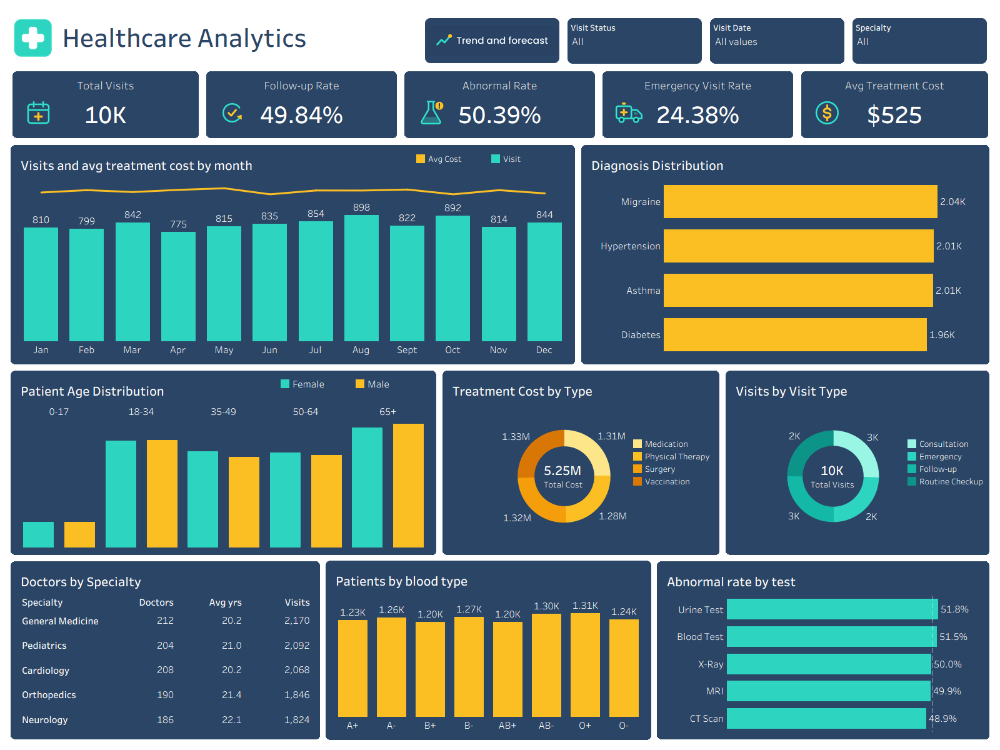
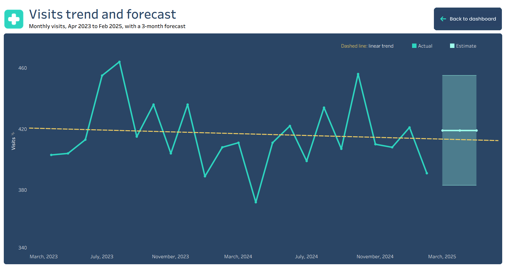

# Healthcare Analytics Dashboard (Tableau)

An interactive Tableau dashboard that analyses patient visits, treatments, doctors and lab results for a healthcare provider. It includes KPI cards, filters, click-to-filter charts, and a separate trend and forecast page.

## Dashboard preview

### Main dashboard


### Trend and forecast page


## What the dashboard answers

- How many visits are there, and how do they change over time?
- What share of visits need a follow-up, and what share are emergencies?
- Which diagnoses, visit types and treatment types are most common, and what do they cost?
- How are patients spread by age group, gender and blood type?
- Which lab tests most often return abnormal results?
- How busy is each medical specialty, and how experienced are its doctors?
- Is there a trend in monthly visits, and what does the next quarter look like?

## KPIs

| KPI | Value |
|---|---|
| Total visits | 10,000 |
| Follow-up rate | 49.84% |
| Abnormal rate | 50.39% |
| Emergency visit rate | 24.38% |
| Average treatment cost | $525 |

Values are for the full date range, 22 Mar 2023 to 21 Mar 2025, with no filters applied.

## Dashboard pages and features

**Main dashboard**
- 5 KPI cards with custom icons
- Filters: Visit Status, Visit Date and Specialty
- Visits and average treatment cost by month (bars and line)
- Diagnosis distribution
- Patient age distribution by gender
- Treatment cost by type and visits by visit type (donut charts)
- Doctors by specialty (doctors, average years of experience, visits)
- Patients by blood type
- Abnormal rate by lab test

**Trend and forecast page**
- Monthly visits from April 2023 to February 2025 (partial months excluded)
- Linear trend line and a 3-month forecast with a 95% prediction interval

**Interactivity**
- Click-to-filter between charts
- Navigation buttons between pages
- Custom tooltips

## Data

The data comes from a MySQL database with five related tables. It is synthetic sample data created for practice, so it contains no real patients.

| Table | Contents |
|---|---|
| `patient` | Demographics, blood type, chronic conditions, insurance provider |
| `visit` | Diagnosis, reason for visit, visit status, follow-up required, doctor, visit date |
| `doctor` | Specialty, hospital or clinic, years of experience |
| `treatments` | Treatment type, outcome, status, medication, cost |
| `lab-result` | Test name, result, reference range, units, test date |

**Relationships:** `visit` links to `patient` on Patient ID, to `doctor` on Doctor ID, and to `treatments` and `lab-result` on Visit ID.

CSV copies of the tables are in the `Data` folder.

## Key calculated fields

```
// Follow-up Rate
SUM(IF [Follow Up Required] = 'Yes' THEN 1 ELSE 0 END) / COUNTD([Visit ID])

// Abnormal Rate (pending tests excluded)
SUM(IF [Test Result] = 'Abnormal' THEN 1 ELSE 0 END)
/ SUM(IF [Test Result] <> 'Pending' THEN 1 ELSE 0 END)

// Emergency Visit Rate
COUNTD(IF [Visit Type] = 'Emergency' THEN [Visit ID] END) / COUNTD([Visit ID])

// Age Group
IF [Age] < 18 THEN '0-17'
ELSEIF [Age] < 35 THEN '18-34'
ELSEIF [Age] < 50 THEN '35-49'
ELSEIF [Age] < 65 THEN '50-64'
ELSE '65+' END
```

## Key findings

- Monthly visits are steady at roughly 420 a month. The trend line is almost flat, and the 3-month forecast stays at about the same level.
- About half of all visits (49.84%) are flagged for follow-up, and about a quarter (24.38%) are emergencies.
- Abnormal results are close to 50% for every lab test, from 48.9% (CT scan) to 51.8% (urine test).
- Diagnoses, visit types, treatment types and blood types are all spread very evenly, which is typical of synthetic data.

## Tools

Tableau Desktop, MySQL. Custom icons and buttons were designed for this project.

## Repository structure

```
├── Dashboard/     Tableau workbook (.twbx)
├── Screenshots/   Dashboard images
├── Data/          CSV exports of the five tables
└── Assets/        KPI icons, buttons and logo
```

## How to open

1. Download `Dashboard/Axon-Healthcare_Tableau.twbx`.
2. Open it in Tableau Desktop or the free Tableau Public app. The data is stored inside the workbook as an extract.

## Author

Vaibhav Gharpankar

LinkedIn: https://www.linkedin.com/in/vaibhav-gharpankar-502b37343/
